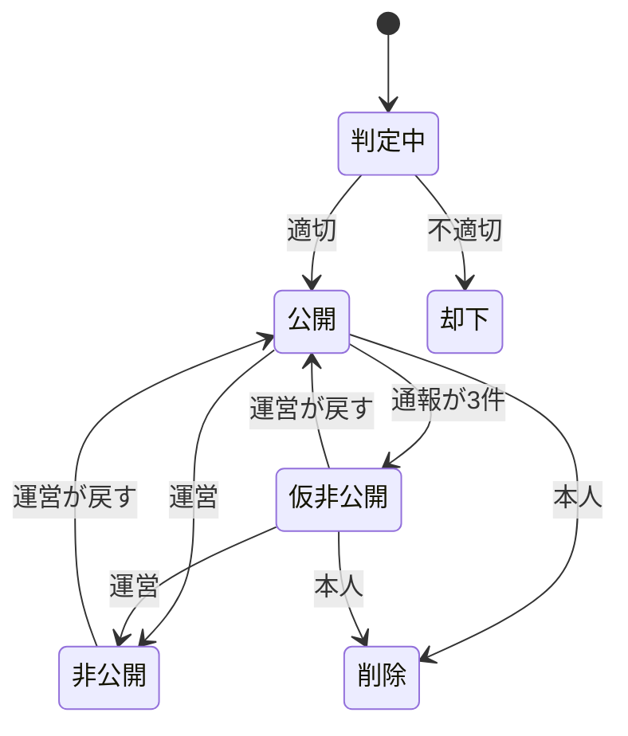

# 陰スタグラム 基本設計

## 1. 機能一覧
| ID | 機能 | 概要 | 主な利用者 | 要求 |
|---|---|---|---|---|
| F-01 | 端末の合言葉 | 初回アクセスで端末ごとのランダムな合言葉を発行し、ブラウザに保存する。自分の投稿の削除・1日の上限・ニックネームごとの一覧・ハートの数を隠す判定に使う | システム | 6, 8, 9, 16 |
| F-02 | 投稿 | ニックネーム（20字）・写真・一言（40字）・場所（任意）・情報の種類。端末で縮小・EXIF 削除 | 投稿者 | 1, 11 |
| F-03 | AI 判定 | Gemini 1回で：不適切かどうか（写真・一言）、キラキラ度（0〜100）と理由、顔の位置 | システム | 2, 4, 5 |
| F-04 | 陰フィルター | キラキラ度に比例して彩度を下げる・暗くする・粒子・周辺減光。顔は全員ぼかす。ブラウザで加工し、加工後だけを保存 | システム | 3, 4 |
| F-05 | タイムライン | 新しい順・人気順（ハート数＋新しさ）・陰度順。情報の種類とハッシュタグで絞り込み | 閲覧者 | 3, 15, 17 |
| F-06 | ハート | 1端末1投稿1回。本人には数を返さない | 閲覧者 | 6 |
| F-07 | 返信 | 40字、写真なし。AI チェック、通報の対象。返信にハートはなし | 閲覧者 | 14 |
| F-08 | 通報 | 投稿・返信を理由付きで通報。3件で自動的に仮非公開 | 閲覧者 | 7, 14 |
| F-09 | 自分の投稿・返信の削除 | 合言葉が一致するものを消す | 投稿者 | 8 |
| F-10 | 会場マップ | 会場マップ画像の上に場所のピン。ピンには直近の状況（混雑・売り切れ）と投稿数。古い状況は薄く表示 | 閲覧者 | 12 |
| F-11 | 場所ごとのページ | 場所の名前・種類・状況のまとめ・その場所の投稿 | 閲覧者 | 13 |
| F-12 | ハッシュタグ | 一言・返信の `#タグ` を抜き出して保存。タグのページで一覧 | 閲覧者 | 15 |
| F-13 | ニックネームごとの一覧 | 同じ端末（合言葉）の投稿をまとめて表示。URL は合言葉から作った別の ID で、合言葉そのものは出さない | 閲覧者 | 16 |
| F-14 | 運営の管理 | 通報の一覧、投稿・返信の非公開と戻し | 運営 | 7 |
| F-15 | 場所の管理 | 会場マップ画像のアップロード、場所（名前・種類＝模擬店／企画／エリア／設備、ピンの座標）の登録 | 運営 | 11, 12 |
| F-16 | 開催期間の設定 | 開始日・終了日。投稿締切（終了＋7日）と全削除（終了＋30日）を自動で決める | 運営 | 10 |
| F-17 | 自動削除 | 全削除日を過ぎたら投稿・返信・画像を消す（Cron） | システム | 10 |
| F-18 | 運営ログイン | Slack ログイン（良良タイムズ・隠酒と同じアプリ） | 運営 | - |

## 2. 画面一覧
| ID | 画面 | 利用者 | 主な要素 |
|---|---|---|---|
| S-01 | タイムライン（/） | 閲覧者 | 並び替え（新しい・人気・陰度）、種類の絞り込み、投稿カード、「投稿する」、下部ナビ（タイムライン／マップ／投稿／自分） |
| S-02 | 投稿（/post） | 投稿者 | ニックネーム、写真、一言、場所を選ぶ（マップかリスト）、情報の種類、AI に送る注意、今日の残り枚数 |
| S-03 | 判定中・結果（/post/result） | 投稿者 | 「キラキラ度を測っています…」→ 点数と理由、陰化アニメーション、「タイムラインへ」 |
| S-04 | 投稿の詳細（/p/{id}） | 閲覧者 | 写真、一言、場所、種類、キラキラ度と理由、ハート、返信の一覧と入力、通報、自分の投稿なら削除 |
| S-05 | 会場マップ（/map） | 閲覧者 | マップ画像、ピン（状況の色・投稿数）、ピンを押すと場所の要約 → S-06 |
| S-06 | 場所のページ（/places/{id}） | 閲覧者 | 名前・種類、状況のまとめ（最新の混雑・売り切れと何分前か）、その場所の投稿 |
| S-07 | ハッシュタグ（/tags/{tag}） | 閲覧者 | そのタグの投稿 |
| S-08 | ニックネームの一覧（/u/{publicId}） | 閲覧者 | ニックネーム、その端末の投稿。自分なら「自分の投稿」として削除ボタン |
| S-10 | 運営ログイン（/admin/login） | 運営 | Slack でログイン |
| S-11 | 運営：通報（/admin/reports） | 運営 | 通報の多い順（投稿・返信）、非公開・公開に戻す |
| S-12 | 運営：場所（/admin/places） | 運営 | マップ画像、ピンを置いて場所を登録・編集 |
| S-13 | 運営：設定（/admin/settings） | 運営 | 開催期間、運営メンバー |

## 3. 状態の流れ（投稿・返信）

- 返信は写真がないため、判定は一言の AI チェックだけ

## 4. 状況の鮮度（マップ・場所のページ）
- 混雑・待ち時間、売り切れ・状況の投稿は「状況」として扱い、場所の最新の状況にする
- 30分以内は通常表示、30分〜2時間は「◯分前」と薄く表示、2時間を過ぎたらマップの状況から外す（投稿自体は残る）（暫定）
- おすすめ・感想、穴場・豆知識、ただの日常は時間で薄くならない

## 5. 設計方針
- 写真は端末で縮小し、Worker から Gemini に1回だけ送る。元の写真は保存しない
- 陰フィルターと顔のぼかしはブラウザで加工し、加工後だけをアップロードする。判定時に発行した一時トークンで、判定した写真と加工後の写真を縛る（寸法と、判定時に端末で計算した縮小画像のハッシュを照合）
- ハートの数は API の時点で本人（合言葉一致）には返さない。ニックネームの一覧の URL は合言葉から作った公開用 ID を使う
- 合言葉はブラウザに保存する。ブラウザを変えると自分の投稿は消せなくなる（画面で案内）
- 会場マップは運営がアップロードした画像に、0〜1 の座標でピンを置く。位置情報（GPS）は使わない

## 6. 決定（11/16）
- 顔：全員必ずぼかす
- 並び順：人気順（ハート数＋新しさ）と陰度順（元がキラキラだった順）
- 地図：会場マップ上の場所を選ぶ
- 残す情報：混雑・待ち時間、売り切れ・状況、おすすめ・感想、穴場・豆知識
- SNS 機能：場所ごとのページ、返信、ハッシュタグ、ニックネームごとの投稿一覧
